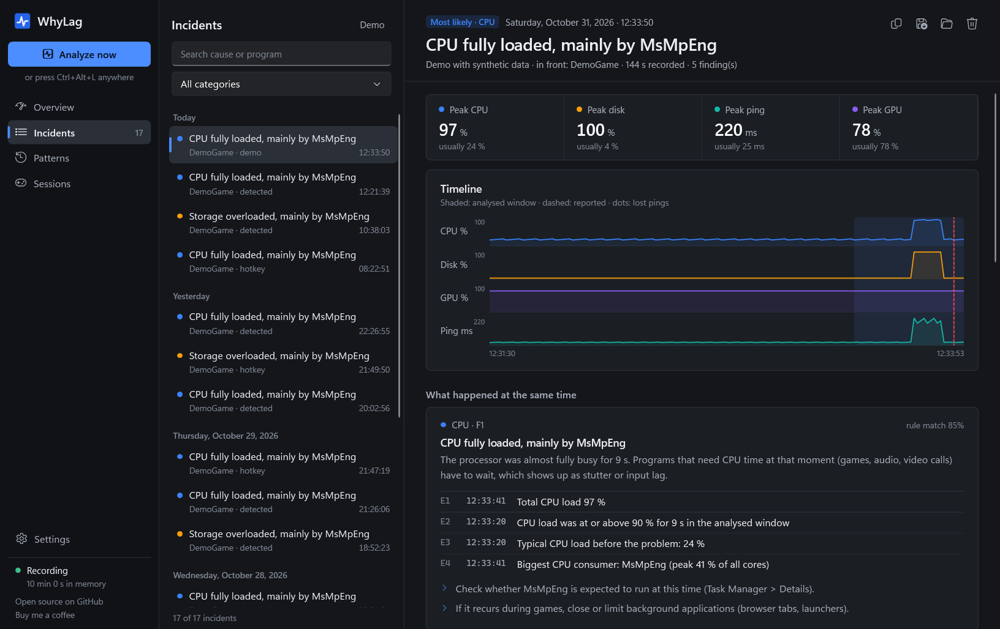
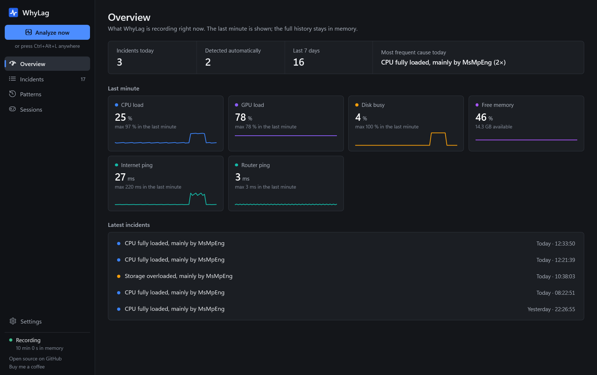

# WhyLag

**Press a key when your PC stutters – WhyLag shows what happened in the seconds before, with evidence.**

Local-first · no telemetry · no admin rights · works without AI · 7 languages

## Why

A game hitches, a call freezes, the mouse hangs – and when you open Task Manager it is over. WhyLag records the last
minutes in memory, so the moment can still be analysed afterwards.

## Features

- **Rolling recording** (1 sample/s, in RAM): CPU, disk, memory, GPU, per-process load, network, ping to router and
  internet, TCP retransmissions, Wi-Fi signal and roaming, frame times of the game in front (PresentMon), driver
  DPC/interrupt time and Windows events.
- **Incidents** via hotkey (`Ctrl+Alt+L`), button or automatic detection of freezes, game hitches and network spikes.
- **19 transparent rules** – e.g. *"Storage overloaded, mainly by MsMpEng"* or *"Delay already between PC and router"* –
  each with measured evidence and timestamps. Simple threshold rules are JSON; [add your own](docs/rules.md).
- **Session reports** after every fullscreen game: average and 1 % low fps, hitches and the most frequent causes.
- **Update check-up**: driver and Windows updates after which lag became clearly more frequent.
- **More causes**: slow memory leaks over hours, temperatures (via HWiNFO or LibreHardwareMonitor) and other devices
  filling your line (router traffic via UPnP, optional).
- **Overlay** with fps, frame time, load, temperatures and ping – a normal topmost window, nothing is injected into games.
- **Recurring patterns**: *"6× seen · usually between 21:00 and 23:00 · mostly on Tuesday"*.
- **Incident table** with search, category filter and bulk delete; each report lists the recorded Windows events
  and keeps your own note.
- **Driver latency (optional)**: a small elevated helper names drivers that block the CPU (audio crackles, input lag).
- **Local AI (optional)**: a model on your PC via [Ollama](https://ollama.com) explains findings in plain language.
  Every statement must cite evidence; invented numbers are removed. Cloud models are never used.
- **Shareable Markdown and HTML reports** (with timeline) with user and computer name removed.

| | Reliability Monitor | WPR/WPA | CapFrameX | LatencyMon | **WhyLag** |
|---|---|---|---|---|---|
| History of the exact moment | – | expert | frames only | live only | ✓ |
| Links processes, disk, network, drivers, events | – | manual | – | drivers only | ✓ |
| Plain-language result | – | – | – | partly | ✓ |

## Install

Windows 10 22H2 / 11, x64. Per user, no admin rights, no .NET needed.

| Variant | How |
|---|---|
| Installer | `WhyLag-<version>-setup.exe` from [Releases](https://github.com/Felixitus/whylag/releases) |
| winget | `winget install WhyLag.WhyLag` *(once accepted into winget)* |
| Portable | extract `WhyLag-<version>-win-x64-portable.zip`, run `WhyLag.exe` |
| Source | `git clone https://github.com/Felixitus/whylag.git` → `dotnet run --project src/WhyLag.App` (.NET 10 SDK) |

Releases include `SHA256SUMS.txt`. Builds are not code-signed yet, so SmartScreen may warn once (see
[Code signing](#code-signing)). WhyLag checks GitHub once a day for a new version; turn it off in Settings.

## Usage

1. WhyLag starts in the tray. **Live overview** shows what it records; **Demo** shows a sample report.
2. When something lags, press **Ctrl+Alt+L** and click the notification.
3. **Recurring patterns** collects causes that keep coming back; **All incidents** lists everything in a table.
4. Too many automatic incidents from one program? Use *Ignore hitches in …* in the report, or pause detection for an
   hour from the tray menu.

Shortcuts in the window: `F5` refresh, `Del` delete the open incident, `Ctrl+C` copy its report.

### Optional features

| Feature | Setup |
|---|---|
| Frame times | Uses bundled [Intel PresentMon](https://github.com/GameTechDev/PresentMon) (MIT). Needs admin rights or the *Performance Log Users* group – *Settings → Frame times → Allow* sets it up once. |
| Driver latency per driver | *Settings → Driver latency*. Asks for admin approval when WhyLag starts. Without it, DPC/interrupt time per core is still recorded. |
| Wi-Fi details | On Windows 11 24H2+ allow *Location → desktop apps*. Network names are never stored. |
| Temperatures | Run [HWiNFO](https://www.hwinfo.com) (with *Shared Memory Support*) or [LibreHardwareMonitor](https://github.com/LibreHardwareMonitor/LibreHardwareMonitor) (as administrator, so it publishes WMI sensors). |
| Router traffic | *Settings → Network*. Needs UPnP on the router (e.g. FRITZ!Box: *Home Network → Network → Allow access for applications*). |
| Local AI | Install Ollama, then *Settings → Local AI*. WhyLag suggests a model for your hardware (e.g. `qwen3:4b`, 2.5 GB, Apache-2.0) and downloads only after you confirm. |

## Privacy

Everything stays on your PC – no telemetry, no accounts. The only network traffic is one ping per second to your router
and `1.1.1.1` (configurable). Incidents are JSON files you can read and delete. Details: [docs/privacy.md](docs/privacy.md).

| Data | Location |
|---|---|
| Settings, incidents, logs | `%LOCALAPPDATA%\WhyLag\` |
| Program (installer) | `%LOCALAPPDATA%\Programs\WhyLag` |

Uninstall via *Windows Settings → Apps* or `winget uninstall WhyLag.WhyLag`; it asks whether to delete your data.

## Limits

- WhyLag shows what happened **at the same time** – a strong hint, not proof.
- System metrics are sampled once per second; frame times capture every frame.
- Game-server lag is not measurable from the PC; WhyLag shows whether your side was fine.
- Games with anti-cheat may hide frames from PresentMon.

## Troubleshooting

| Problem | Fix |
|---|---|
| Hotkey does nothing | Another program uses it – change it in Settings. |
| Warning about missing counters | `lodctr /R` in an admin prompt repairs damaged Windows counters. |
| No frame rate | Only continuously rendering programs (≥ 10 fps) are measured; check Settings → Frame times. |
| "Ollama is not reachable" | Start Ollama; default address `http://127.0.0.1:11434`. |
| Driver helper stopped | Another kernel-trace tool (e.g. LatencyMon) is running. |

## Command line

`whylag-cli record | demo | explain latest | ai-status | changes | router | rules | latency-test | export-fixture | diag | list | show`

Run `whylag-cli help` for options.

## Contributing

Wrong diagnoses, new rules, translations (one JSON file per language) and tests on other hardware are welcome –
see [CONTRIBUTING.md](CONTRIBUTING.md) and [docs/architecture.md](docs/architecture.md). A wrong diagnosis is most
useful as a test case: `whylag-cli export-fixture <id> --expect <rule>` writes an anonymized fixture for
`tests/WhyLag.Core.Tests/Fixtures`. *Settings → Data → Create bug report* collects logs and system info in a ZIP.

## Code signing

Release builds are set up for free code signing by [SignPath Foundation](https://signpath.org) once the project is
accepted; the release workflow signs `WhyLag.exe`, `whylag-cli.exe` and the installer as soon as the SignPath
organization is configured. Policy: only binaries built by GitHub Actions from this repository's tagged sources are
signed, and every release is approved by the maintainer.

## License

[Apache-2.0](LICENSE). Bundled and optional third-party components: [THIRD_PARTY_NOTICES.md](THIRD_PARTY_NOTICES.md).
AI models have their own licenses, shown before any download.
